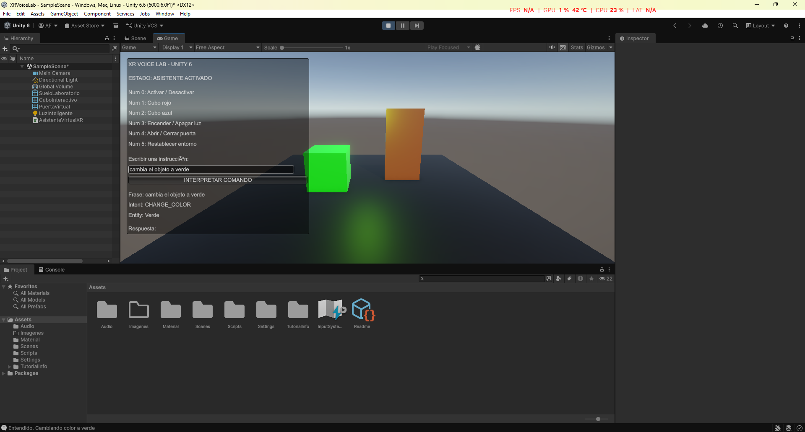
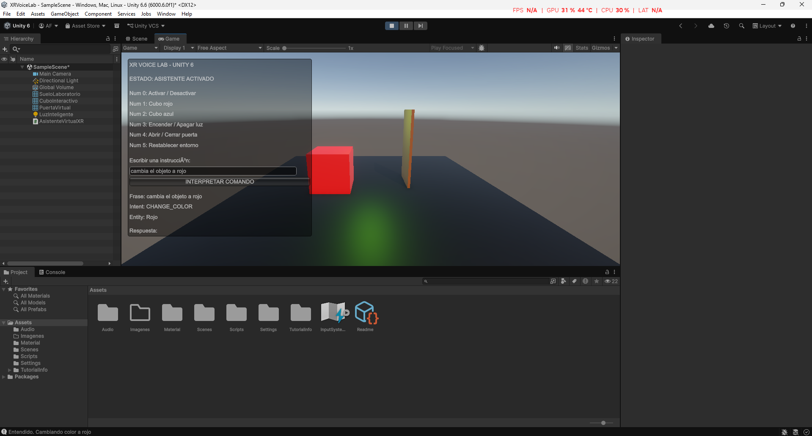
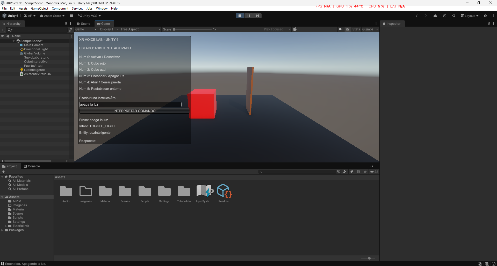

# XR Voice Lab

Asistente de voz simulado para **Realidad Extendida** en Unity 6 (URP): interpreta órdenes en lenguaje natural y actúa sobre un cubo, una luz y una puerta. Cada acción se confirma con una **campanita**.

> Laboratorio de Realidad Extendida para Videojuegos · Guía de práctica 11: *Interfaces de Voz y Procesamiento de Lenguaje Natural (NLP)*

| Unity | Render | Input |
|---|---|---|
| 6 (6000.6.0f1) | URP 17.6 | Input System 1.20 |

## Qué hace

- Reconoce **intenciones (Intent)** y **entidades (Entity)** a partir de frases como *“cambia el objeto a verde”* o *“apaga la luz”*.
- Tolera variantes: ignora mayúsculas y tildes y acepta sinónimos (*enciende / prende / activa*).
- Controla **color del cubo**, **iluminación** y **puerta** (abre/cierra girando 90°).
- Reproduce un **sonido de campanita** como confirmación de cada acción.
- Panel en pantalla con estado, frase, intención, entidad y respuesta del asistente.

## Controles

| Tecla | Acción |
|---|---|
| `Num 0` | Activar / desactivar el asistente |
| `Num 1` | *Cambia el cubo a rojo* |
| `Num 2` | *Pon el cubo azul* |
| `Num 3` | Encender / apagar la luz |
| `Num 4` | Abrir / cerrar la puerta |
| `Num 5` | Restablecer el entorno |

También puedes escribir cualquier frase en el campo de texto y pulsar **INTERPRETAR COMANDO**.

## Intenciones soportadas

| Intención | Ejemplos | Acción |
|---|---|---|
| `CHANGE_COLOR` | “cambia el objeto a **rojo / azul / verde**” | Cambia el color del cubo |
| `TOGGLE_LIGHT` | “**enciende / apaga** la luz” | Enciende o apaga la luz |
| `CONTROL_DOOR` | “**abre / cierra** la puerta” | Gira la puerta 90° |
| `RESET_ENVIRONMENT` | “**restablece** el entorno” | Vuelve a los valores iniciales |
| `DESCONOCIDA` | cualquier otra frase | “No comprendo esa instrucción.” |

## Capturas

| Cubo verde | Cubo rojo + puerta abierta | Luz apagada |
|---|---|---|
|  |  |  |

## Cómo ejecutarlo

1. Abre el proyecto con **Unity 6000.6.0f1**.
2. Carga `Assets/Scenes/SampleScene.unity`.
3. Pulsa **Play** y activa el asistente con `Num 0`.

## Estructura

```
Assets/
├── Scripts/AsistenteXRSimulado.cs   # NLP, control del entorno y confirmación
├── Scenes/SampleScene.unity         # Laboratorio con cubo, luz y puerta
├── Audio/AudioConfirmacion.mp3      # Campanita de confirmación
├── Material/                        # Materiales del cubo, puerta y suelo
└── Imagenes/                        # Capturas del README
```

## Cómo funciona

1. **Entrada:** tecla del teclado numérico o frase escrita (simula el ASR).
2. **Normalización:** texto a minúsculas y sin tildes.
3. **NLU:** detección de intención y entidad por palabras clave.
4. **Acción:** cambia el material, la luz o la rotación de la puerta y dispara su `UnityEvent`.
5. **Confirmación:** mensaje en pantalla/consola + campanita.

## Notas

- El reconocimiento es **local y simulado**: no usa micrófono ni servicios en la nube. La lógica de intenciones está centralizada en `ProcesarFrase()`, lista para sustituirse por **Wit.ai** o **Meta Voice SDK**.
- El asistente debe estar activo (`Num 0`) antes de aceptar órdenes.
